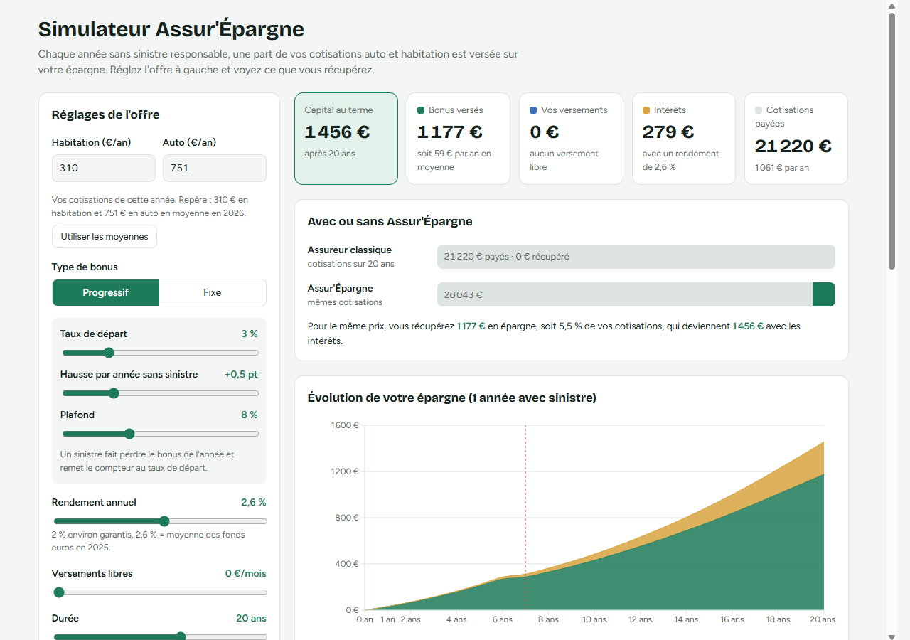

# Assur'Épargne

**Simulateur d'épargne fidélité pour un client d'assurance.**
Chaque année sans sinistre, l'assureur reverse un bonus (un pourcentage des cotisations) sur une épargne qui rapporte des intérêts. L'application calcule le capital obtenu au bout de N années et montre son évolution année par année.

Projet full-stack : une **API REST en Java / Spring Boot** et une **interface en React**.

<!-- Ajoute une capture d'écran ici :  -->

---

## Fonctionnalités

- Saisie des cotisations annuelles **auto et habitation**.
- Choix du **type de bonus** : progressif (taux de départ, hausse par année sans sinistre, plafond) ou fixe.
- Réglage du **rendement** et de la **durée** (5 à 30 ans) avec des curseurs, calcul en direct.
- **Grille des sinistres** auto et habitation : un clic sur une année déclare un sinistre, un second clic le retire.
- Résultats :
  - tuiles **capital au terme**, **bonus versés**, **intérêts** et **cotisations payées** ;
  - comparaison **avec ou sans Assur'Épargne** ;
  - **graphique** de l'évolution de l'épargne (Recharts) ;
  - **tableau** détaillé année par année, avec le taux du bonus.
- **Validation** des saisies côté API : une cotisation négative renvoie une erreur `400` avec un message par champ.

## Règle métier

Pour chaque année `n` de la simulation :

1. **Chaque contrat (auto, habitation) a son propre compteur** d'années sans sinistre. Un sinistre sur un contrat remet son compteur à 0, sans toucher à l'autre.
2. Le taux de bonus dépend du mode choisi :
   - `AUCUN` : pas de bonus ;
   - `FIXE` : un taux constant (ex. 10 %) ;
   - `VARIABLE` : `tauxDepart + increment × (annéesSansSinistre − 1)`, limité par un `plafond`.
   - Une année avec sinistre ne donne jamais de bonus.
3. `bonus = cotisation auto × taux auto + cotisation habitation × taux habitation`
4. `capital = capital précédent × (1 + rendement) + bonus + versements libres de l'année`

**Exemple :** 1 000 € de cotisations par an, bonus fixe de 10 %, rendement de 2 %.
L'année 1, le capital vaut 100 €. L'année 2, il vaut 100 × 1,02 + 100 = 202 €.

## Stack technique

| Partie | Technologies |
|---|---|
| Back | Java 21, Spring Boot 4, Spring Web MVC, Bean Validation, Maven |
| Tests | JUnit 5, MockMvc |
| Front | React 19, Vite, Recharts |

## Architecture

```
ASSUR-EPARGNE/
├── ASSUR_EPARGNE_BACK/              API Spring Boot (port 8090)
│   └── src/main/java/fr/assurance_expargne/demo/
│       ├── Controller/   SimulationController    → POST /api/simulations/client
│       ├── Service/      ClientSimulationService → crée un Contrat par assurance, appelle le moteur
│       │                 SimulationEngine        → boucle année par année
│       │                 BonusCalculator         → taux de bonus selon le mode
│       ├── DTO/          objets de requête et de réponse (records Java)
│       ├── Model/        BonusMode (AUCUN, FIXE, VARIABLE), Contrat (cotisation + sinistres)
│       └── Exception/    GlobalExceptionHandler  → erreurs 400 lisibles
│
└── ASSUR_EPARGNE_FRONT/             Interface React (port 5173)
    └── src/Service/
        ├── ProfilForm.jsx       formulaire, état et appel de l'API
        ├── GrilleSinistres.jsx  une case par année, clic = sinistre
        ├── Tuiles.jsx           capital final et total des bonus
        ├── Graphique.jsx        courbe de l'épargne
        └── TableauAnnees.jsx    détail par année
```

En développement, le **proxy Vite** redirige les appels `/api` du front vers `http://localhost:8090`. Le navigateur ne voit donc qu'une seule origine.

## Lancer le projet

**Prérequis :** Java 21 et Node.js 20 ou plus récent.

**1. Le back**

```bash
cd ASSUR_EPARGNE_BACK
./mvnw spring-boot:run          # Windows : mvnw.cmd spring-boot:run
```

L'API démarre sur `http://localhost:8090`.

**2. Le front** (dans un second terminal)

```bash
cd ASSUR_EPARGNE_FRONT
npm install
npm run dev
```

Ouvre ensuite `http://localhost:5173`.

**3. Les tests**

```bash
cd ASSUR_EPARGNE_BACK
./mvnw test
```

## API

`POST /api/simulations/client`

<details>
<summary>Exemple de requête et de réponse</summary>

```json
{
  "cotisationAuto": 700,
  "cotisationHabitation": 300,
  "versementMensuel": 0,
  "sinistresAuto": [3],
  "sinistresHabitation": [],
  "rendement": 0.02,
  "duree": 3,
  "mode": "FIXE",
  "tauxFixe": 0.10,
  "tauxDepart": 0,
  "increment": 0,
  "plafond": 0
}
```

```json
{
  "capitalFinal": 236.04,
  "bonusTotal": 230.0,
  "detailParAnnee": [
    { "annee": 1, "capital": 100.0,  "bonus": 100.0, "bonusAuto": 70.0, "bonusHabitation": 30.0 },
    { "annee": 2, "capital": 202.0,  "bonus": 100.0, "bonusAuto": 70.0, "bonusHabitation": 30.0 },
    { "annee": 3, "capital": 236.04, "bonus": 30.0,  "bonusAuto": 0.0,  "bonusHabitation": 30.0 }
  ]
}
```

</details>

Si une cotisation est négative, l'API répond `400 Bad Request` :

```json
{ "cotisationAuto": "Le capital initial doit être supérieur à 0" }
```

## Pistes d'amélioration

- Utiliser `BigDecimal` pour les montants, au lieu de `double`.
- Mise en ligne (back et front déployés).

## Auteur

**Cyril Houilliez** · [GitHub](https://github.com/CyrilHLZ)
